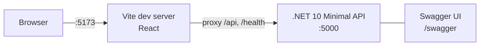
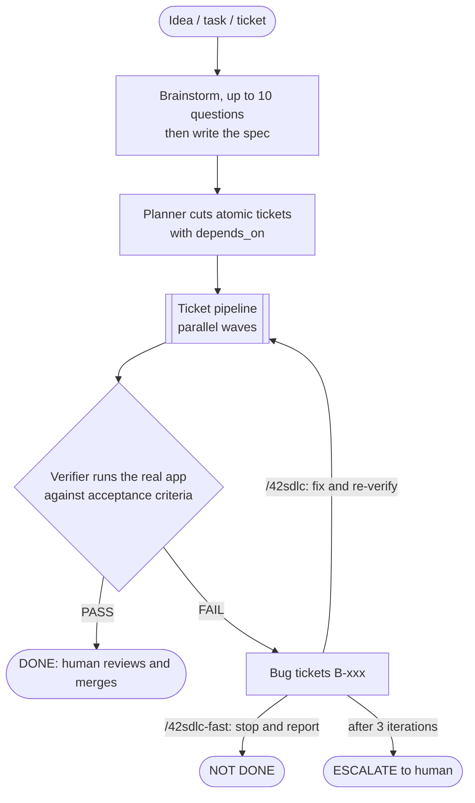
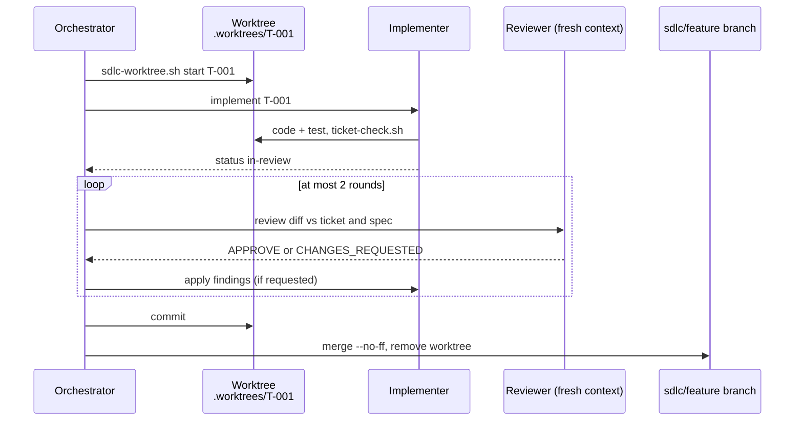
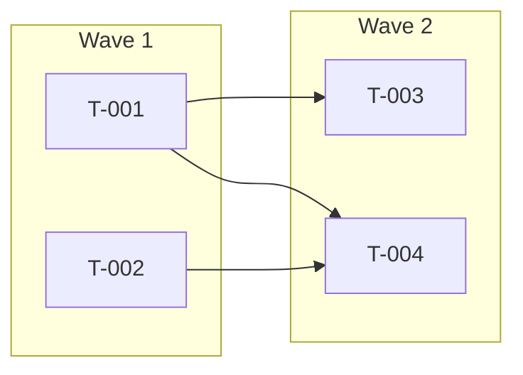
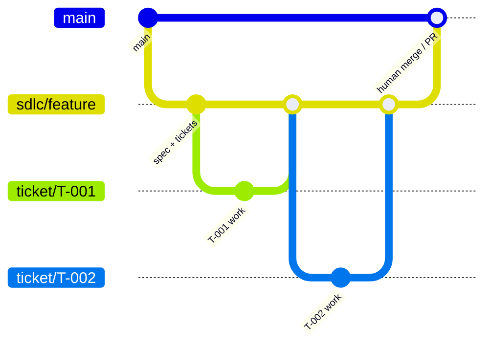

# 42

An autonomous, full-SDLC workflow for AI coding agents: **idea → spec → tickets → parallel build → clean-context review → real verification → auto-fix**, on top of a minimal FE/BE scaffold.

A strong model turns an idea into a spec and atomic tickets. Cheap models implement the tickets in parallel, each in its own git worktree. A reviewer that has never seen the implementer's reasoning checks every change before it merges. A verifier then runs the real app against the acceptance criteria and files any failure as a bug ticket. Nothing reaches `main` without a human.

> **Status: early.** The scaffold, the orchestration skills, and CI plus a deploy workflow exist. The deploy workflow is untested, and there is no persistent runner (see [Roadmap](#roadmap)).

## Quick start

The scaffold is a hello-world app that proves the browser → API round trip.

**Backend**: .NET 10 Minimal API in a single file, with Swagger.

```bash
cd backend/src/Api
dotnet run                      # http://localhost:5000/swagger
curl localhost:5000/health      # {"status":"ok","time":"..."}
```

No local .NET 10 SDK? Run it in Docker:

```bash
docker run --rm -p 127.0.0.1:5000:5000 -v "$PWD/backend/src/Api":/src -w /src \
  -e ASPNETCORE_URLS=http://0.0.0.0:5000 -e ASPNETCORE_ENVIRONMENT=Development \
  mcr.microsoft.com/dotnet/sdk:10.0 dotnet run --no-launch-profile
```

**Frontend**: Vite + React (Node 20.19+).

```bash
cd frontend
npm install
npm run dev                     # http://localhost:5173
```

Vite proxies `/api` and `/health` to the backend (`BACKEND_URL`, default `http://localhost:5000`), so no CORS setup is needed in development.



## The Forge

Two commands drive the loop. They are agent skills in `.agents/skills/` (Claude Code: `/42sdlc-fast`, `/42sdlc`).

| Command | Input | Behavior |
|---|---|---|
| `/42sdlc-fast <input>` | idea text, ticket IDs, a ticket path, or a feature name | One pass: build and verify. Reports DONE, or files bugs and stops. |
| `/42sdlc <input>` | same | Same, then implements the filed bugs and re-verifies, up to 3 iterations, then escalates to you. |



### Roles

| Role | Model | Job |
|---|---|---|
| Orchestrator (your session) | session model | Brainstorm, write the spec, schedule waves, commit and merge |
| `sdlc-planner` | opus | Spec → atomic tickets with `depends_on` |
| `sdlc-implementer` | haiku | One ticket, one worktree, runs the ticket checks |
| `sdlc-reviewer` | sonnet | Clean-context, read-only review: APPROVE or CHANGES_REQUESTED |
| `sdlc-verifier` | sonnet | Runs the real app: PASS or FAIL, plus bug files |

Role definitions are in `.agents/agents/`.

### One ticket



A ticket that fails review twice becomes `blocked` with the reason recorded. A merge conflict goes back to the implementer, then through review again.

### Parallel waves

Tickets declare `depends_on`. Every ticket whose dependencies are merged runs in the same wave, and a wave finishes merging before the next starts.



### Branches



The flows never merge into `main`, push, or deploy. At the end, review `git log main..sdlc/<feature>` and merge or open a PR yourself.

## Repository layout

```
backend/src/Api/        .NET 10 Minimal API (Program.cs, Api.csproj)
frontend/               Vite + React app
.agents/skills/         42sdlc, 42sdlc-fast, sdlc-spec, sdlc-ticket
.agents/agents/         planner, implementer, reviewer, verifier roles
backend/Dockerfile      production image for Cloud Run
frontend/netlify.toml   Netlify config
.github/workflows/      ci.yml, deploy.yml (Cloud Run + Netlify)
docs/forge.md           Forge overview and diagrams
docs/specs/             feature specs (_TEMPLATE.md)
docs/features/          feature tickets (_TEMPLATE.md)
docs/bugs/              bug tickets (_TEMPLATE.md)
scripts/
  sdlc-worktree.sh      deterministic git plumbing: feature, start, commit, merge
  ticket-check.sh       per-ticket build and test checks
```

Ticket `status` goes `todo → in-progress → in-review → done`, or `blocked`.

## Known gaps

- The scaffold has no tests, so the reviewer and verifier rely on `ticket-check.sh` builds plus manual API and browser checks.
- Orchestration is prompt-driven: no persisted run state, retries, or cost budget.
- Model routing is Claude Code specific. Other agents can follow the same skills sequentially.

## Roadmap

- [ ] Tests for the scaffold (xUnit, Vitest)
- [ ] Docker Compose for one-command local run
- [ ] Run the deploy workflow once end to end (needs the GCP and Netlify setup in `architecture.md`)
- [ ] Workload Identity Federation instead of a service-account key
- [ ] A small runner that persists run state and enforces budgets

## License

MIT, see [LICENSE](LICENSE).
