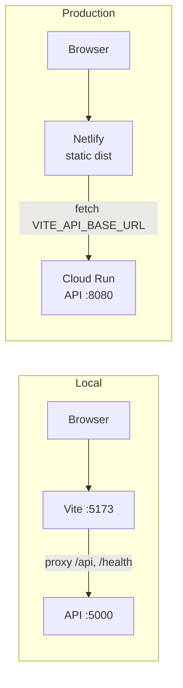

# Architecture Overview

A map of the codebase for agents and people. The agent-driven SDLC is described in `docs/forge.md`. Update this file when structure, data flow, or infrastructure changes.

## 1. Project Structure

```
/
├── backend/
│   ├── src/Api/
│   │   ├── Program.cs              # the whole API: Swagger, CORS, endpoints
│   │   ├── Api.csproj              # net10.0, Swashbuckle.AspNetCore
│   │   └── Properties/launchSettings.json   # http://localhost:5000
│   ├── Dockerfile                  # sdk build → aspnet runtime, port 8080
│   └── .dockerignore
├── frontend/                       # Vite + React (JavaScript)
│   ├── src/App.jsx                 # health check + greeting form
│   ├── src/main.jsx
│   ├── vite.config.js              # dev proxy: /api and /health → backend
│   └── netlify.toml                # SPA redirect, Node 24
├── .agents/
│   ├── skills/                     # 42sdlc, 42sdlc-fast, sdlc-spec, sdlc-ticket
│   └── agents/                     # sdlc-planner, -implementer, -reviewer, -verifier
├── .github/workflows/              # ci.yml, deploy.yml
├── docs/
│   ├── forge.md                    # 42 Forge: SDLC flows and diagrams
│   ├── specs/                      # feature specs (_TEMPLATE.md)
│   ├── features/                   # feature tickets (_TEMPLATE.md)
│   └── bugs/                       # bug tickets (_TEMPLATE.md)
├── scripts/                        # sdlc-worktree.sh, ticket-check.sh
└── README.md, agents.md, architecture.md
```

## 2. System Diagram



## 3. Components

### Backend

`Program.cs` is a single file with no database.

| Method | Route | Response |
|---|---|---|
| GET | `/health` | `200 {status, time}` |
| GET | `/api/hello?name=` | `200 {message}` |
| GET | `/swagger`, `/swagger/v1/swagger.json` | Swagger UI and OpenAPI document |

CORS allows only the origins in `Cors:AllowedOrigins` (set `Cors__AllowedOrigins__0` in the environment). In development the Vite proxy makes CORS unnecessary.

### Frontend

One page. It calls `/health` on load and `/api/hello` from a form. `VITE_API_BASE_URL` is empty in development (the proxy handles it) and set at build time for production.

## 4. Deployment

GitHub Actions:
- **`ci.yml`** runs on every push and PR: builds the backend, builds the frontend, and builds the backend Docker image.
- **`deploy.yml`** runs after CI succeeds on a push to `main`, in the `production` environment:
  1. Builds and pushes the backend image to Artifact Registry, then runs `gcloud run deploy`.
  2. Builds the frontend with the new Cloud Run URL and deploys it to Netlify with `netlify-cli`.

Required in the `production` environment:
- Variables: `GCP_PROJECT_ID`, `GCP_REGION`, `GCP_ARTIFACT_REPOSITORY`, `GCP_CLOUD_RUN_SERVICE`, `GCP_RUNTIME_SERVICE_ACCOUNT`, `FRONTEND_ORIGIN`.
- Secrets: `GCP_SERVICE_ACCOUNT_KEY`, `NETLIFY_AUTH_TOKEN`, `NETLIFY_SITE_ID`.

## 5. Security

- The API has no authentication and is deployed with `--allow-unauthenticated`. Add authentication before exposing real data.
- CI authenticates to GCP with a service-account key. Move to Workload Identity Federation (`TODO(ci-auth)` in `deploy.yml`).
- The agent flows never merge to `main`, push, or deploy.

## 6. Testing

There are no automated tests yet. `scripts/ticket-check.sh` builds the backend and frontend and runs any test projects it finds.

## 7. Glossary

- **42 Forge:** the spec → ticket → worktree → review → verify flow driven by `/42sdlc-fast` and `/42sdlc`.
- **Ticket / bug:** `docs/features/T-NNN-*.md` and `docs/bugs/B-NNN-*.md`, the atomic units of work.
- **Wave:** a set of tickets whose dependencies are merged, so they can run in parallel.
- **Feature branch:** `sdlc/<feature>`, the integration branch for one spec. Ticket branches are `ticket/<ID>-<slug>`.
